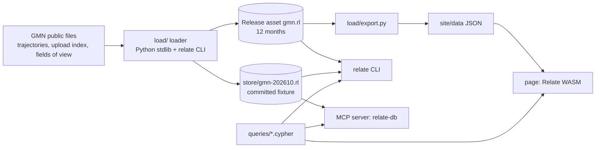

# Second Witness

Which meteor cameras of the [Global Meteor Network](https://globalmeteornetwork.org/) (GMN) work alone, and which ones the network leans on.

A meteor's orbit needs at least two cameras that saw it. Second Witness turns GMN's public trajectory files into a graph of which stations confirm each other, so a volunteer or a country coordinator can see, for any station: what the network loses if it stops, who its only partner is, which camera is running every night with nobody to confirm it, and who it could pair with by turning.

## Use case

GMN has about 1,400 volunteer cameras. Each one uploads its detections every night; an orbit is solved only when two or more cameras saw the same meteor. Nobody sees the network as a network: when a camera goes dark, the operator whose orbits depended on it is not told, and a camera that detects meteors every night but shares none with anyone looks healthy from its own status page.

Second Witness answers, from GMN's own data:

- **Take a station down**: the orbits that lose their second witness, the three-station orbits that drop to two and get less precise, the stations cut off from their island, and each partner with the shared meteors, trajectory IDs and a link that opens the meteor map on that pair.
- **Running with no partner**: cameras that uploaded detections all month and confirmed none. They still count for meteor flux; a missing partner can come from aim, calibration, mask or weather, and the data does not say which.
- **What changed**: stations that stopped since last month and what their partners lost.
- **Who could turn**: for a lonely camera, nearby installed cameras that would share sky if it turned, from GMN's 100 km fields of view, marked as an estimate.
- **Who to talk to**: station codes with a reason, and an optional English message for GMN's mailing list with numbers from the store only.
- **Country report, witness chain and 12-month history**.

## Numbers in this README

Every number below comes from the shared queries on the committed October 2026 store; `tests/test_readme.py` recomputes each row and fails naming it if one differs.

| Claim | Value |
|---|---|
| HU000B: two-station orbits lost if it stops | 899 |
| US004L: stations cut off if it stops | 86 |
| Islands in October 2026 | 18 |
| Cameras running with no partner | 115 |
| ES000C: nights uploaded | 31 |
| ES000C: detections | 1,797 |
| ES000C: orbits | 0 |
| Stations that stopped since September | 46 |
| NZ002C: shared meteors lost to stations that stopped | 408 |

## How it uses Relate

**Mode: single-file `.rl` store.** One month of GMN pairs fits in a file that git can carry (the October 2026 fixture, `store/gmn-202610.rl`, 14.4 MB) and that the `relate` CLI opens or loads from a URL with no server and no account. Twelve months (36.5 MB) are published as a GitHub Release asset, so git history does not grow every month ([ADR-0007](docs/adr/0007-closed-months-as-release-assets.md)). A directory store would not travel as one download, and an in-memory store would not be a store a judge can inspect.

**What the graph models.** `(:Station)-[:SHARED {month, meteors, two_station, sample_ids}]->(:Station)`: two stations share a meteor when both appear in the same trajectory of GMN's monthly file. `(:Station)-[:STATS]->(:Month)` holds each station's month: nights uploaded, detections, orbits, partners, its island, the stations it cuts off, its status and what it lost. `COULD_PAIR`, `NEAREST_ISLAND`, `(:Country)-[:STATS]->(:Month)` and `LINK` (the newest month's pairs, for the chain) complete it. The full model is in [docs/ARCHITECTURE.md](docs/ARCHITECTURE.md).

**What is precomputed and what is live.** Relate 1.2.0 has no graph algorithms, so the loader computes islands, cut points, same-site groups, moved codes and "could pair" once per month and stores them ([ADR-0004](docs/adr/0004-loader-computes-islands-cut-points-and-geometry.md)). Every answer is then live Cypher: the take-down, the chain (`allShortestPaths`), the history and the reports. The same eleven `queries/*.cypher` files run in three places with equal rows, checked by tests: the `relate` CLI, the page (Relate's WebAssembly build in the browser) and an MCP server (`relate-db`).



**What the graph cannot know.** A camera that uploads zero detections may face clouds or have a broken lens; both look the same in the index. The participating-stations column lists only the stations GMN's solver kept, so a pair's count undercounts who saw a meteor. Slow re-entry events fall outside GMN's pipeline. "Could pair" is an estimate from today's fields of view, not a measured orbit. The current month's counts change during the day, because GMN rewrites its files several times a day and its solver goes back several days, so past nights can still gain orbits.

Second Witness reads GMN's static files directly and does not depend on GMN's Datasette.

## Setup and run

You need the `relate` CLI 1.2.0 and Python 3 (standard library only).

```bash
curl -fsSL https://relatedb.ai/install.sh | sh
git clone https://github.com/gmassello/second-witness && cd second-witness
```

**First take-down, offline, from the committed store.** Opening a `.rl` rewrites it, so query a copy:

```bash
# check: prints 899
cp store/gmn-202610.rl /tmp/sw.rl
relate --database /tmp/sw.rl --param station='"HU000B"' --param month='"202610"' "$(cat queries/take_down.cypher)"
```

The first row says `orbits_lost` 899: if HU000B stopped, 899 October orbits would lose their second witness. Parameters are JSON, so the month goes quoted.

**The page** is published at https://gmassello.github.io/second-witness/ and refreshed daily with the current month.

**Without cloning**, Relate loads the store from GitHub:

```bash
relate --load https://github.com/gmassello/second-witness/raw/main/store/gmn-202610.rl \
  "MATCH (s:Station {code: 'HU000B'})-[t:STATS {month: '202610'}]->() RETURN t.two_station_orbits AS orbits_lost, t.three_station_orbits AS third_witness, t.cut_off AS cut_off"
```

**Twelve months** (November 2025 to October 2026), straight from Pages, or with the current month as of today from `gmn-latest.rl`:

```bash
relate --load https://gmassello.github.io/second-witness/gmn.rl \
  "MATCH (m:Month) RETURN m.id AS month ORDER BY month"
```

Or download the release asset:

```bash
curl -L -o store/gmn.rl https://github.com/gmassello/second-witness/releases/download/store-202610/gmn.rl
cp store/gmn.rl /tmp/sw12.rl
relate --database /tmp/sw12.rl --param station='"ES000C"' "$(cat queries/station_history.cypher)"
```

**The page**, locally:

```bash
python3 load/export.py --store store/gmn-202610.rl
python3 -m http.server 8000 --bind 127.0.0.1 --directory site
```

Then open `http://127.0.0.1:8000/#/station/HU000B`. Every station and country has its own link (`#/station/ES000C`, `#/country/ES`, `#/turn/ES000C`, `#/talk/NZ002C`, `#/chain/DE0001/HU000B`, `#/history/station/ES000C`, `#/changes`), in English or Spanish, light or dark, plain or technical.

**The MCP server** for a coding agent (stdio, read-only, seven named tools: `take_down`, `lonely_cameras`, `country_report`, `who_could_turn`, `talk_to`, `witness_chain`, `station_history`):

```bash
python3 -m venv .venv && .venv/bin/pip install relate-db==1.2.0
.venv/bin/python mcp/server.py                     # the October fixture
.venv/bin/python mcp/server.py --store store/gmn.rl  # twelve months
```

A recorded agent run asking about HU000B is in [docs/agent-run.md](docs/agent-run.md).

**Tests**:

```bash
python3 -m unittest discover -s tests && node --test
```

**Rebuild from GMN** (downloads about 100 MB a month into `research/raw/`):

```bash
python3 load/build.py --rebuild 202610
```

## Where the data lives

- `store/gmn-202610.rl`: October 2026, committed, the store a judge can open offline.
- `store-202610` [release asset](https://github.com/gmassello/second-witness/releases/tag/store-202610) `gmn.rl`: twelve months, November 2025 to October 2026; `data/months.json` lists it.
- `site/data/`: the page's JSON, exported from the store by Cypher queries, never committed.
- `queries/`: the eleven questions, shared by the page, the MCP server and the CLI.
- `docs/`: the product brief, plan, architecture and decisions.

Nothing personal is stored: GMN publishes stations by code only, and so does Second Witness.

## Works with the meteor map

Every pair Second Witness shows links to GMN's [meteor map](https://tammojan.github.io/meteormap/) (GPL-3.0) on that month, filtered to the meteors both stations saw and centred on the pair, so a coordinator checks the number in a tool GMN volunteers already use. Second Witness adds the network view the map does not have: who depends on whom, and what a take-down costs. It does not copy the map's code.

## Data and credit

Data: Global Meteor Network, licensed CC BY 4.0, from https://globalmeteornetwork.org/data/. As GMN asks, please cite the site and Vida et al. (2020) and Vida et al. (2021), as listed on that page.

Code: MIT ([LICENSE](LICENSE)).
