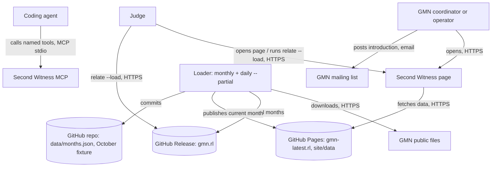
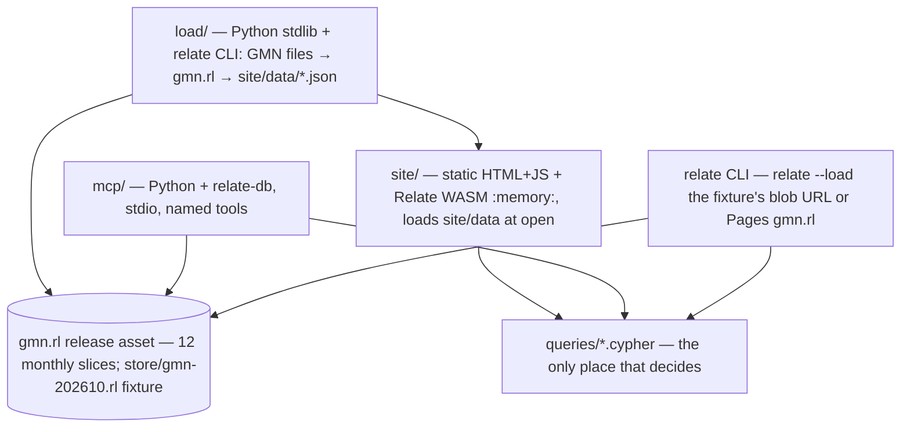

# Second Witness — Architecture

**Status:** planned (describes the intended design; the README describes what is built) · **Date:** 2026-11-23

## Summary
One set of Cypher queries over one Relate store, used through three adapters — a static page running Relate's WebAssembly build, a small MCP server with named tools, and the `relate` CLI — fed by a loader that publishes closed months as GitHub Release assets and the current month daily on Pages; it accepts that the cut points, the islands and the "could pair" geometry are computed by the loader and stored in the graph, because Relate 1.2.0 has no graph algorithms and a pure-Cypher cut-point query ran for over 10 min (S4).

## Drivers
| ID | Quality attribute | Scenario (source, stimulus, environment, response) | Measure | From |
|---|---|---|---|---|
| QA-01 | Installability | A judge opens the public page on broadband with no account, key or server; the first take-down answer appears | ≤ 10 s from first byte (S6: 2.5 MB gzipped WASM + ~1.5 MB data + 1.1 s load per month) | R5, R13 |
| QA-02 | Installability | A judge runs the README's one command against the store's public URL (the October fixture in the repo, or the 12-month store on Pages) | ≤ 5 s on broadband (S5: 0.20 s with the 33 MB store served locally) | R5, R6 |
| QA-03 | Time behaviour | A coordinator presses "Take it down" on any station of the latest month | ≤ 1 s in the browser (S6: 7 ms) | R2 |
| QA-04 | Capacity | The store holds 12 months and the repo does not grow with them | release asset ≤ 2 GB (U3, rebuilt 2026-11-27: `store-202610` with 12 real months, 36.5 MB); tracked repo ≤ 50 MB, the October fixture 14.4 MB (ADR-0007) | R6, R20 |
| QA-05 | Functional correctness | The page, the MCP tools and the CLI answer HU000B, ES000C and US004L | 100% equal rows; HU000B = 899, ES000C = 31 nights / 1,797 detections / 0 partners, 115 running with no partner (S2, S7) | R7, R16, AE6, AE16 |
| QA-06 | Modifiability | GMN publishes a new month | one command rebuilds the store and the page data | R6 |

Wiki basis: simple first, hexagonal core with adapters, ADR per hard-to-reverse decision, attributes with a number (`knowledge/wiki/system-architecture.md`); lowest rung that works (no LLM in the product), named tools as the agent-computer interface, evals with a recorded trace (`knowledge/wiki/agent-architectures.md`).

## Constraints
| # | Constraint | Source | Confirmed? |
|---|---|---|---|
| C1 | Relate used meaningfully; repo topic `relate`; a persistent store committed or shown in the demo (`docs/HACKATHON.md`); the README says the mode and why | https://relate.devpost.com/rules §3 | yes |
| C2 | Relate 1.2.0 | `relate --version` → `Relate v1.2.0` (S1) | yes |
| C3 | Browser WASM opens only `:memory:` or `opfs://`, never a `.rl` file | https://github.com/relatedb/relate/blob/main/docs/api/wasm/spec.md; `relate.d.ts` exports no byte loader (S6) | yes |
| C4 | Relate's own MCP lists only `read_cypher`, `write_cypher`, `get_schema` | https://github.com/relatedb/relate/blob/main/docs/api/mcp/spec.md | yes (doc) |
| C5 | CLI loads a `.rl` from an http(s) URL, GitHub links included | https://github.com/relatedb/relate/blob/main/docs/api/cli/spec.md (`--load`, ADR-0500); S5 | yes |
| C6 | No graph algorithms (components, articulation points) | docs search for connected components: 0 results; S4 | yes |
| C7 | Deadline 2026-12-11 18:00 PST | `docs/HACKATHON.md` | yes |
| C8 | GMN data CC BY 4.0, cite the site and Vida et al. 2020, 2021 | https://globalmeteornetwork.org/data/ | yes |
| C10 | GMN's field-of-view polygons (`kml_fov/<CODE>-100km.kml`, about 2.5 KB each) describe the current pointing only; the dated pointing history is `kml_fov/GMN_station_coordinates_public.json` (2.0 MB, positions rounded to 2 decimals) | GET on 2026-11-25: listing 200 in 11.3 s, 593 KB, about 1,820 stations × 3 heights; `ES001G-100km.kml` 200 in 0.8 s, one lon/lat polygon at 100 km, no azimuth | yes |
| C11 | GMN's nightly camera summary (`weblog/<CC>/<CAM>/
_detected/
_observation_summary.json`, ~1.8 KB, string values), the weblog status page per country and the daily trajectory file `traj_summary_data/daily/traj_summary_yesterday.txt` are public; daily files are cut by 1° of solar longitude (`solrange` in the name), not by UTC day, and every trajectory file starts with `# Summary generated on <UTC>`; an old night's summary can be missing | GET on 2026-11-25: BE0002 night 2026-11-24 summary 200; a 2023-03-09 summary 404; `weblog/BE/` lists status and latest recalibration per camera | yes |
| C9 | No new dependencies beyond the sponsor's packages, pinned: `relate` CLI 1.2.0, `relate-db==1.2.0`, `@relate/relate-wasm@1.2.0` | `projects/hackathon/CLAUDE.md` § Dependencias | yes |

## Options considered
| | A — the boring one | B — shared queries | C — hosted server |
|---|---|---|---|
| What it looks like | Static page on WASM; agents use `relate serve --mcp` with `read_cypher` and the README's queries | Same page; `queries/*.cypher` read by the page, by our MCP server (named tools on `relate-db`) and by the CLI | `relate serve --http` on a VM; the page calls it |
| Scenario it favours | QA-01, fewest processes | QA-05 (one place decides), R7 as written | QA-01 on slow devices (no WASM download) |
| Scenario it sacrifices | R7 (no named tools; the agent writes Cypher itself) | one more process (~100 lines of Python) | R5 "no server", QA-01 when the VM is down |
| What breaks first | the agent's hand-written Cypher | the MCP server's Python version | the VM before judging ends on 2026-12-16 |
| Cost to operate | GitHub Pages only | GitHub Pages only | a VM and its uptime |
| **Cost to exit** | low | low: the queries are plain files any adapter can read | medium: the page depends on an API |

Chosen: **B**, because it keeps "no server" and makes the page, the agent and the CLI read the same query files, so their numbers cannot diverge. settled: user-approved

## Chosen design

### Context

### Containers

### Components
| Component | Responsibility (one sentence) | Technology | Covers |
|---|---|---|---|
| Query module `queries/` | One `.cypher` file per question, with its parameters, read verbatim by every adapter | Cypher (Relate 1.2.0) | R2, R3, R4, R8, R10, R11, R12, R13, R15, R16, R17, R19, R20, R21 |
| Loader `load/` | Downloads a month from GMN, writes its slice into `gmn.rl`, computes islands, cut points, same-site groups, moved codes and "could pair" geometry, then exports the page data by querying the store | Python 3 stdlib + `relate` CLI (`--fetch-params rows=…` + `UNWIND $rows`) | R1, R6, R8, R11, R12, R14, R20, R21, R22, R24 |
| Store `gmn.rl` | The graph: 12 monthly slices of stations, pairs and stats, published as the asset of the latest GitHub Release; the repo commits only the October 2026 fixture `store/gmn-202610.rl` (ADR-0007) | Relate single-file bundle, JSON snapshot codec | R6, R9 |
| Page `site/` | Opens on the whole network's fragility with running cameras with no partner beside it; take-down, country, changes, could turn, talk to, chain, history; one link per station and country | Static HTML+JS, `@relate/relate-wasm@1.2.0` in `:memory:`, GitHub Pages; built in U5: `site/model.js` (load, queries, routes, trap guard; tested in Node), `site/app.js` (DOM), `site/text.js` (EN/ES, plain/technical), `site/vendor/relate-wasm/` (7.2 MB WASM from npmjs.org, integrity checked, `trap.js` patched for Firefox), `site/queries` a symlink to `queries/` that the deploy replaces with a copy; ready in 2.6 s on a desktop from the local dev server with the newest month's pairs (2026-11-27), the previous month loaded on demand (`loadPairs`) | R3, R4, R5, R8, R13, R14, R17, R18, R19, R20, R21, R22, R23, R24 |
| MCP server `mcp/` | Named tools that run the same query files on a local `.rl` (the October fixture by default, or the downloaded release asset) | Python + `relate-db==1.2.0`, MCP over stdio | R7 |
| CLI path | The judge's one command: `relate --load https://github.com/gmassello/second-witness/blob/main/store/gmn-202610.rl "<query from queries/>"` for October (`--max-rows 0`: under an agent harness the CLI prints at most 100 rows and adds a `rowCap` line), or the 12-month store at `https://gmassello.github.io/second-witness/gmn.rl`, which the Pages deploy copies from the latest release (S8: `--load` refuses release URLs) | `relate` CLI 1.2.0 | R5, R6, R16 |
| README | Mode (single-file `.rl`) and why, what the graph models, what it cannot know, first take-down, data citation | Markdown | R9 |
| Parity test | Runs each query through WASM, `relate-db` and the CLI and compares rows; anchors the BRIEF's numbers | Node + Python test | R16, AE6, AE16 |

### Contracts
- **Queries**: `queries/<name>.cypher`, one statement, parameters `$station`, `$country`, `$month`, `$other` and `$text` (search), `$month` always a `YYYYMM` string (on the CLI `--param month='"202610"'`, since a bare number is parsed as JSON and `substring` then fails); a query never picks a default month, the adapter does. Queries return codes, not copy: `status`, `effect` (`loses_only_partner`, `left_with_one`), `reason` (`could_pair`, `only_partner`, `only_partner_stopped`, `different_islands`, `no_partner`), `change` and `mark`; the page and the MCP map them to text. Every pair row carries its `sample_ids`, its meteor map `link` and the CC BY 4.0 credit, built in `take_down.cypher` only. Names: `network` (islands, cut points, top losses, single-partner count and each country's two-station share for the first screen), `lonely_cameras`, `take_down`, `country`, `changes`, `could_turn`, `talk_to`, `chain`, `station_history`, `country_history`, `search`, `last_night`; `lonely_cameras` and `take_down` also return `cause` and `cause_source`. Adapters never edit or concatenate them.
- **MCP tools** (stdio, `readOnlyHint: true`): `lonely_cameras {country?, month?}`, `take_down {station, month?}`, `country_report {country, month?}`, `who_could_turn {station, month?}`, `talk_to {station, month?}`, `witness_chain {from, to, month?}`, `station_history {station}`. Each returns `{query, parameters, rows}` so the agent sees which query answered. Built in U9 as `mcp/server.py`, a stdlib JSON-RPC loop on `relate-db==1.2.0` opened read-only: protocol versions 2025-06-18, 2025-03-26 and 2024-11-05; `-32700`, `-32601` and `-32602`; `title`, `readOnlyHint`, `outputSchema` and `structuredContent` plus a text copy; a missing `month` resolves to the store's latest and `parameters` says which; an unknown station gives empty rows with `isError` false, the expected code format and up to 3 similar codes, same-country first. `who_could_turn` runs `could_turn`, `country_report` runs `country`, `witness_chain {from, to}` runs `chain`. A recorded agent run is in `docs/agent-run.md`.
- **Loader**: `python3 load/build.py <YYYYMM>…` adds or replaces months in `store/gmn.rl` (gitignored; `--fresh --store store/gmn-202610.rl` writes the committed fixture); `--rebuild <YYYYMM>` rebuilds the 12 months ending there; `--release <YYYYMM>` uploads the store as the asset `gmn.rl` of release `store-<YYYYMM>` and writes `data/months.json` (tag, months, URL, bytes), whose commit keeps the scheduled workflows enabled (ADR-0007); `--partial [--as-of DATE]` loads the current month into a copy of the store as `store/gmn-latest.rl`, published on Pages and never released or committed (ADR-0006). Writes go through one `relate query` stdin session per month, 1,000 rows per `UNWIND` statement, on a temporary copy renamed at the end, so a failure leaves the store untouched. It stops with a non-zero exit before writing when a trajectory file does not have 86 columns.
- **Page data** (U4): `python3 load/export.py` reads the store with Cypher (`properties()` of every node and relationship) and writes `site/data/stats.json` (12 `Month`, 47 `Country`, 1,905 `Station` without `fov100`, 16,485 station and 522 country `STATS` rows; 4.9 MB, 0.49 MB gzipped) and `site/data/pairs-<YYYYMM>.json` for the two newest months (`SHARED`, `COULD_PAIR`, `NEAREST_ISLAND`; October 4.0 MB, 0.61 MB gzipped), measured 2026-11-27 on `store-202610`. The older months' `SHARED` go to `site/data/partners-<CC>.json`, one file per country with every pair that touches one of its stations, without `sample_ids` (43 files, 19.5 MB in all; the largest, UK, 7.4 MB and 0.48 MB gzipped; Spain 25 KB), imported with `site/cypher/partners.cypher` (`MERGE`, so a pair in two countries' files is not doubled) only when a station's history opens (HU000B's 12 months in 1.3 s in Node). Opening the page fetches `stats.json` and the newest pairs file: 8.9 MB, about 1.1 MB over the wire with gzip. `site/cypher/stats.cypher`, `pairs.cypher` and `link.cypher` rebuild the graph in `:memory:` with `UNWIND … SET x += r`; the loader writes `LINK` with the same `link.cypher`, and a test rebuilds the graph from the exported files and compares eleven query answers with the store's. `site/data/` is build output, git-ignored, made by the deploy.
- **Deploy** (U11): `.github/workflows/pages.yml` on every push to main and daily at 06:23 UTC downloads the latest release's `gmn.rl`, runs `build.py --partial` into `gmn-latest.rl` (if GMN has no file for the month yet, it warns and publishes the release alone), exports the page data, replaces the `site/queries` symlink with a copy, copies `gmn.rl` and `gmn-latest.rl` into `site/`, checks the title, `stats.json` and both stores before uploading, and after deploying polls the public URL for the title and `data/stats.json`. GMN downloads keep their `ETag` and `Last-Modified` beside the file (`<file>.headers`), so a daily run whose `ETag` is unchanged gets a 304 and downloads nothing; `research/raw` survives between runs in the Actions cache. `.github/workflows/monthly.yml` runs `build.py --monthly` daily: from day 15 it rebuilds and releases the previous month; when a released month's `Last-Modified` at GMN differs from the one `months.json` recorded, it re-downloads that month, rebuilds the window and replaces the latest release; then it commits `data/months.json`. The page shows "data not found" when `data/stats.json` is missing.
- **Links**: `#/station/<code>`, `#/country/<cc>` (the printable monthly report: its cameras split by `status` so the groups add up to its total, cut points, neighbour countries, nearest island, stopped and new, lonely), `#/changes`, `#/turn/<code>`, `#/talk/<code>` (codes with a reason from `talk_to`: `could_pair` as an estimate, `only_partner`, `partner_stopped` from the previous month with `was_only`, whose pairs the view loads first; plus an optional English message built in `site/views/talk.js` from those rows only, with the meteor map link of each pair it cites), `#/chain/<from>/<to>`, `#/history/station/<code>` and `#/history/country/<cc>` (12 months from `station_history` and `country_history`; the country rows mark when its number of islands went up or down); each view in `site/views/<name>.js` exports `data(app, route)` (tested in Node) and `render(v, ui)`; optional `?month=YYYYMM` follows with U8.
- **Proof link out** (R3, R17): `https://tammojan.github.io/meteormap/?data=YYYY-MM&stations=A;B`; `;` keeps meteors seen by all listed stations, `data` of 7 characters loads that monthly file. Checked on 2026-11-25: ES001G;ES0013 for 2026-10 shows 144 meteors, equal to our count from the GMN file; the page takes about 40–50 s to load a month (ADR-0005).
- **`relate-db` rows**: `dict(record)`; a record iterates its keys, so `zip(columns, record)` gives the column names twice (S7).

### Data
- **Nodes**: `(:Station {code, country, lat, lon, pos_month, site, fov100, fov100_date})`, where `pos_month` is the latest loaded month that set the position, so reloading an older month never moves a station back, and where `lat`/`lon` are GMN's public 2-decimal values (published as GMN publishes them, with no offset of our own: operators already choose how precise their public position is, D27) `site` is that 2-decimal position as text (`"40.12,-3.45"`), so cameras with the same public position share a site (947 cameras at 269 sites in October 2026), and `fov100` is the current 100 km polygon from `kml_fov` as a flat `[lon, lat, …]` list with `fov100_date` the date its file was fetched; `(:Country {code, name})`, `(:Month {id, partial, as_of, generated, sigma2_median, sigma3_median})`, where `generated` is GMN's `# Summary generated on` time and the sigmas are the median `Vgeo sigma` (column 16, km/s) of the month's two- and three-station trajectories. Every code of `GMN_station_coordinates_public.json` is a `Station`, so a known station with no `STATS` that month reads as `no_upload`.
- **Relationships**:
  - `(:Station)-[:SHARED {month, meteors, two_station, sample_ids}]->(:Station)`, stored once per pair with `a.code < b.code`, queried undirected; every pair counts as partners whatever the distance (BRIEF Assumptions: 7,424 two-station orbits under 50 km in October 2026); `site` only groups co-located cameras for display.
  - `(:Station)-[:STATS {nights, detections, orbits, two_station_orbits, three_station_orbits, partners, island, cut_off, status, change, lost, upload, az, alt, last_upload, cause, cause_source}]->(:Month)`, where `island` is the smallest code of the station's connected piece of `SHARED` that month and `cut_off` the stations left outside the largest remaining piece when it is taken down (one iterative Tarjan pass with subtree sizes, `load/graph.py`), where `last_upload` is the upload index stamp, the night's recording start (about 17 h before the upload, D26), with `cause` ∈ `decommissioned`, `upload_failure`, `clock`, `partial_night`, `cloudy`, `old_calibration`, `unknown` from GMN's nightly summary and weblog status (the first that applies, in that order, decided by one function in `load/gmn.py`; `partial_night` is `total_fits/total_expected_fits` under 0.5), and with `upload` ∈ `running`, `late`, `dark`, `silent` only in the partial month, from `last_upload` plus 17 h against `--as-of` (over 36 h, 3 days and 7 days), and with `az`/`alt` from the latest dated entry of `GMN_station_coordinates_public.json` on or before the month's last day, `status` ∈ `paired`, `running_no_partner`, `uploaded_zero`, `no_upload` (this month's activity; `no_data` follows in U13), `change` ∈ `stopped` (orbits last month, none this month), `possibly_moved` (stopped while a new code appeared at its `site`), `new` (orbits this month, none last month) or null, and `lost` the meteors the station shared last month with stations that stopped. The previous month comes from the same run, else the store, else the cached trajectory file, so the October fixture alone answers the change view.
  - `(:Country)-[:STATS {month, orbits, two_station_orbits, three_station_orbits, two_station_share, running_no_partner, islands}]->(:Month)`, where `orbits` and `three_station_orbits` count distinct trajectories with at least one station of the country, never a sum per camera.
  - `(:Station)-[:LINK {month, meteors}]->(:Station)`, a copy of the newest month's `SHARED` that the chain walks: Relate 1.2.0's `shortestPath` takes no property filter, and a `WHERE all(...)` over its relationships ran over 120 s on the October fixture against 0.13 s without it, so the chain always answers on the store's newest month and says which.
  - `(:Station)-[:COULD_PAIR {month, turn_deg, to_az, km, km2, estimate: true, fov_date, aim_changed}]->(:Station)`, from a running camera with no partner and known aim to an installed camera 5–600 km away (the solver's pair range, `CorrelateEngine.py`): the lonely camera's current 100 km polygon (the first `<Polygon>` of each KML: the footprint at 100 km, mask-aware, coordinates in lon,lat order) is rotated about the station until it faces the centroid of the other's polygon, `turn_deg` is that rotation (positive clockwise), `to_az` the azimuth it gives, and `km2` the overlap after turning, sampled on a 40×40 grid with ray-casting in local km; only the 5 largest overlaps per camera, `fov_date` the older polygon's date, and `aim_changed` true when either station has a pointing entry newer than the month. Computed with the standard library in `load/geometry.py`; the polygons of the lonely cameras and their candidates are fetched by name and kept when a fetch fails.
  - `(:Station)-[:NEAREST_ISLAND {month, km}]->(:Station)` from each island to its nearest other island, between their closest cameras (haversine on the public positions), one edge per pair of islands.
  - `(:Station)-[:SHARED_NIGHT {night, meteors}]->(:Station)`, the pairs of the latest daily file `traj_summary_yesterday.txt`, with `night` the UTC range its trajectories span, only in the published partial store.
- **Size**: measured in U1 on the real data with up to three trajectory IDs per pair: October 2026 alone 14.4 MB (1,904 stations, 1,447 with data that month including the 16 that stopped without uploading, 25,442 pairs, 348 `COULD_PAIR`); November 2025 – October 2026 36.5 MB (16,019–27,391 pairs a month, 4,559 `COULD_PAIR`; U3 added known stations, country stats and `LINK`), built in about 5 min from the cache, most of it the overlap sampling (U2, 2026-11-27; 30.9 MB and 17 s before the graph properties; before folding `_2` codes: 1,444 stations, 25,525 October pairs). S5's synthetic estimate was 33.2 MB.
- **Owner and retention**: the loader is the only writer; 12 months rolling; GMN keeps the source files.
- **Nothing personal**: station codes only; no operator names or contacts (BRIEF Safety).

## Failure modes
| What fails | What happens | How it is detected | How it recovers |
|---|---|---|---|
| GMN changes the trajectory columns | the loader stops before writing | non-zero exit, column count in the message | fix the parser; the published store stays as it was |
| GMN is down | nothing at runtime: the page reads Pages and the CLI reads the release | loader download error | retry later |
| WASM traps (panic) | the page instance is unusable | `isWasmTrap(err)` | the page shows a reload message |
| Page data and store diverge | page numbers differ from CLI/MCP | parity test in CI | re-run the export step |
| A browser without WebAssembly | the page cannot answer | feature check at load | the page links to the CLI command and the README's screenshots |
| `kml_fov` is slow or down (the listing took 11 s, and over 120 s for another client) | `COULD_PAIR` cannot be refreshed | download timeout | each polygon is fetched by name (`<CODE>-100km.kml`, 0.8 s); on failure the previous polygons and their `fov_date` stay |
| A trajectory row lists a station twice | a pair or multiplicity counted twice | unit test on a repeated station | stations are deduplicated per row and matched exactly |
| The weblog or a nightly summary is slow, down or missing | no fresh cause | download timeout or 404 | the cause stays `unknown` or keeps the previous day's value, with its night shown |
| The daily job fails or GMN has not updated | the page keeps the previous day's partial month | the page shows `as_of`; uptime goes red when `as_of` or `Month.generated` is more than 2 days old | re-run the job; closed months are never touched |
| The release asset grows past 2 GB, or the tracked repo past 50 MB | the upload fails; QA-04 broken | size check in CI and in the monthly job | drop `sample_ids` to one per pair (S5: 13.2 MB without them) |
| GitHub disables the scheduled workflows after 60 days without activity | the daily and monthly jobs stop | uptime red when `as_of` is more than 2 days old | `gh workflow enable`; the monthly `data/months.json` commit normally prevents it |

## Spikes
| ID | Assumption | Experiment | Success criterion | Result | Plan B |
|---|---|---|---|---|---|
| S1 | Relate 1.2.0 installs and loads a remote `.rl` | `install.sh`; `relate --version`; `relate --load https://github.com/relatedb/relate/blob/main/test.rl …` | version 1.2.0; remote load answers | **passed**: `Relate v1.2.0`, signature verified; the sample `test.rl` URL returns HTTP 404, so the remote load was proven with our own store in S5 | — |
| S2 | The BRIEF's numbers come out of Cypher on a real store | throwaway export of `research/raw/202610` → 1,444 stations, 25,525 pairs, 1,431 uploads, loaded with `--fetch-params` + `UNWIND` | HU000B = 899; ES000C 31 / 1,797 / 0; 115 running with no partner | **passed**: all three exact; load 0.6 s; each query 20–40 ms including process start | — |
| S3 | `shortestPath` answers the chain | DE0001 → HU000B; ES0019 → DE0001 | a path in < 1 s; no rows across islands | **passed**: DE0001–LU0001–DE0008–PL000L–HU000B in 30 ms; ES0019 → DE0001 no rows in 20 ms; ES0019's island is 17 stations in ES and PT | — |
| S4 | Islands and cut points in pure Cypher within 5 s | reachability from US004L; `shortestPath` with `NONE(m IN nodes(p) WHERE m = x)` from a hub to every station | US004L cuts off 86 | **failed**: plain reachability 50 ms (176 stations), but the predicate query ran over 10 min and was stopped | loader computes `island` and `cut_off` per station and month and stores them; pages read them with Cypher (ADR-0004) |
| S5 | 12 months fit the repo and load fast | synthetic store: 12 × October's pairs | ≤ 50 MB; `--load` from URL + take-down ≤ 5 s | **passed**: 33.2 MB (13.2 MB without IDs; 18.5 MB gzipped); `--load http://127.0.0.1/y12.rl` + take-down 0.20 s; take-down on the 12-month store 0.16 s | one trajectory ID per pair |
| S6 | The page can hold a month and answer fast | Node 24, `@relate/relate-wasm@1.2.0`, `:memory:`, October via `UNWIND $rows` | load ≤ 5 s; take-down ≤ 1 s | **passed**: WASM 6.9 MB (2.5 MB gzipped), init 31 ms, load 1,064 ms, queries 2–7 ms, chain 3 ms; no API takes `.rl` bytes | — |
| S8 | `relate --load` follows a GitHub Release redirect | a small `.rl` uploaded to a test release `s8-test` (deleted after); `relate --load https://github.com/gmassello/second-witness/releases/download/s8-test/u.rl` + count | the count answers | **failed** (2026-11-25): Relate refuses it by design, "a GitHub releases URL is not a single-file store; the blob or raw form fetches the file's bytes"; the CLI wrote a 2,500-node `.rl` in batches of 1,000 through one `relate query` stdin session | the release stays the archive; the Pages deploy serves the latest asset as `gmn.rl` for `--load`; offline, `curl -L -o store/gmn.rl <release url>` and `relate --database store/gmn.rl` |
| S7 | `relate-db` gives the CLI's rows | `relate.connect("oct.rl", read_only=True)`, three queries, compared to `relate --mode jsonl` | equal rows | **passed**: equal for HU000B, ES000C and US004L's partners, 0.3–0.4 ms | — |

All spikes ran on 2026-11-23 against the real October 2026 data or a synthetic 12-month copy of it; their scripts stay in the session scratchpad and are not part of the repo.

## Decisions
- [ADR-0001](adr/0001-shared-cypher-queries-three-adapters.md) — one set of Cypher files read by the page, the MCP server and the CLI
- [ADR-0002](adr/0002-committed-store-and-page-data-from-the-store.md) — monthly slices in a committed `.rl`; the page data is exported from the store
- [ADR-0003](adr/0003-own-mcp-server-with-named-tools.md) — our own MCP server with named tools over `relate-db`
- [ADR-0004](adr/0004-loader-computes-islands-cut-points-and-geometry.md) — islands, cut points, same-site groups, moved codes and "could pair" are computed by the loader and stored in the graph
- [ADR-0006](adr/0006-daily-partial-month-published-not-committed.md) — the current month reloads daily as a partial slice published on Pages; only closed months are committed
- [ADR-0005](adr/0005-fov-from-gmn-kml-and-proof-links-to-meteor-map.md) — "could pair" from GMN's 100 km field-of-view polygons, and every pair's proof links to the meteor map
- [ADR-0007](adr/0007-closed-months-as-release-assets.md) — closed months published as GitHub Release assets; a fixed October fixture committed

## Out of this design
- None of R1–R24 is left without a component. Deferred by the BRIEF and not designed here: placing a new camera, months beyond 12, other networks (EDMOND, FRIPON).
