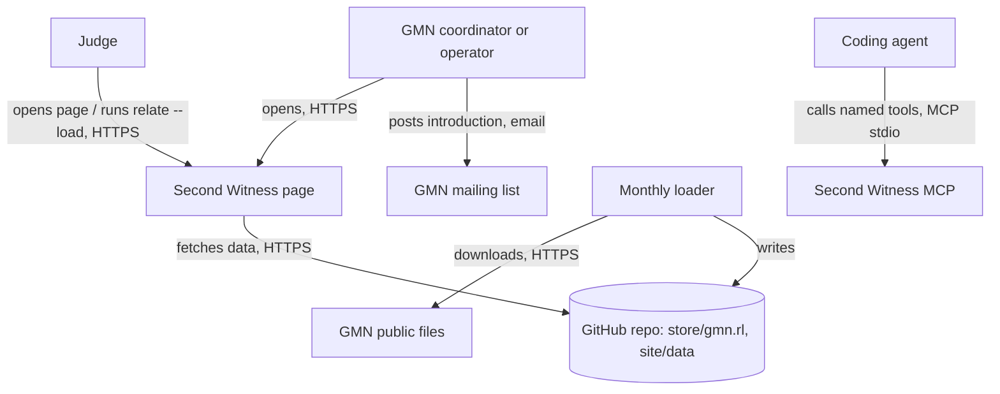
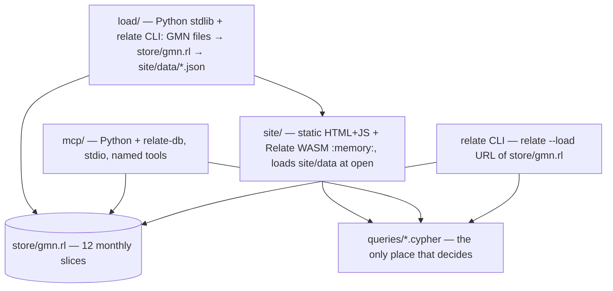

# Second Witness — Architecture

**Status:** planned (describes the intended design; the README describes what is built) · **Date:** 2026-11-23

## Summary
One set of Cypher queries over one Relate store, used through three adapters — a static page running Relate's WebAssembly build, a small MCP server with named tools, and the `relate` CLI — fed by a monthly loader; it accepts that the cut points, the islands and the "could pair" geometry are computed by the loader and stored in the graph, because Relate 1.2.0 has no graph algorithms and a pure-Cypher cut-point query ran for over 10 min (S4).

## Drivers
| ID | Quality attribute | Scenario (source, stimulus, environment, response) | Measure | From |
|---|---|---|---|---|
| QA-01 | Installability | A judge opens the public page on broadband with no account, key or server; the first take-down answer appears | ≤ 10 s from first byte (S6: 2.5 MB gzipped WASM + ~1.5 MB data + 1.1 s load per month) | R5, R13 |
| QA-02 | Installability | A judge runs the README's one command against the committed store's URL | ≤ 5 s on broadband (S5: 0.20 s with the 33 MB store served locally) | R5, R6 |
| QA-03 | Time behaviour | A coordinator presses "Take it down" on any station of the latest month | ≤ 1 s in the browser (S6: 7 ms) | R2 |
| QA-04 | Capacity | The committed store holds 12 months | ≤ 50 MB (GitHub refuses files over 100 MB; S5: 33.2 MB) | R6, R20 |
| QA-05 | Functional correctness | The page, the MCP tools and the CLI answer HU000B, ES000C and US004L | 100% equal rows; HU000B = 899, ES000C = 31 nights / 1,797 detections / 0 partners, 115 running with no partner (S2, S7) | R7, R16, AE6, AE16 |
| QA-06 | Modifiability | GMN publishes a new month | one command rebuilds the store and the page data | R6 |

Wiki basis: simple first, hexagonal core with adapters, ADR per hard-to-reverse decision, attributes with a number (`knowledge/wiki/system-architecture.md`); lowest rung that works (no LLM in the product), named tools as the agent-computer interface, evals with a recorded trace (`knowledge/wiki/agent-architectures.md`).

## Constraints
| # | Constraint | Source | Confirmed? |
|---|---|---|---|
| C1 | Relate used meaningfully; repo topic `relate`; a persistent store committed; the README says the mode and why | https://relate.devpost.com/rules §3 | yes |
| C2 | Relate 1.2.0 | `relate --version` → `Relate v1.2.0` (S1) | yes |
| C3 | Browser WASM opens only `:memory:` or `opfs://`, never a `.rl` file | https://github.com/relatedb/relate/blob/main/docs/api/wasm/spec.md; `relate.d.ts` exports no byte loader (S6) | yes |
| C4 | Relate's own MCP lists only `read_cypher`, `write_cypher`, `get_schema` | https://github.com/relatedb/relate/blob/main/docs/api/mcp/spec.md | yes (doc) |
| C5 | CLI loads a `.rl` from an http(s) URL, GitHub links included | https://github.com/relatedb/relate/blob/main/docs/api/cli/spec.md (`--load`, ADR-0500); S5 | yes |
| C6 | No graph algorithms (components, articulation points) | docs search for connected components: 0 results; S4 | yes |
| C7 | Deadline 2026-12-11 18:00 PST | `docs/HACKATHON.md` | yes |
| C8 | GMN data CC BY 4.0, cite the site and Vida et al. 2020, 2021 | https://globalmeteornetwork.org/data/ | yes |
| C10 | GMN's field-of-view polygons (`kml_fov/<CODE>-100km.kml`, about 2.5 KB each) describe the current pointing only; the dated pointing history is `kml_fov/GMN_station_coordinates_public.json` (2.0 MB, positions rounded to 2 decimals) | GET on 2026-11-25: listing 200 in 11.3 s, 593 KB, about 1,820 stations × 3 heights; `ES001G-100km.kml` 200 in 0.8 s, one lon/lat polygon at 100 km, no azimuth | yes |
| C9 | No new dependencies beyond the sponsor's packages, pinned: `relate` CLI 1.2.0, `relate-db==1.2.0`, `@relate/relate-wasm@1.2.0` | `projects/hackathon/CLAUDE.md` § Dependencias | yes |

## Options considered
| | A — the boring one | B — shared queries | C — hosted server |
|---|---|---|---|
| What it looks like | Static page on WASM; agents use `relate serve --mcp` with `read_cypher` and the README's queries | Same page; `queries/*.cypher` read by the page, by our MCP server (named tools on `relate-db`) and by the CLI | `relate serve --http` on a VM; the page calls it |
| Scenario it favours | QA-01, fewest processes | QA-05 (one place decides), R7 as written | QA-01 on slow devices (no WASM download) |
| Scenario it sacrifices | R7 (no named tools; the agent writes Cypher itself) | one more process (~100 lines of Python) | R5 "no server", QA-01 when the VM is down |
| What breaks first | the agent's hand-written Cypher | the MCP server's Python version | the VM before judging ends on 2026-12-16 |
| Cost to operate | GitHub Pages only | GitHub Pages only | a VM and its uptime |
| **Cost to exit** | low | low: the queries are plain files any adapter can read | medium: the page depends on an API |

Chosen: **B**, because it keeps "no server" and makes the page, the agent and the CLI read the same query files, so their numbers cannot diverge. settled: user-approved

## Chosen design

### Context

### Containers

### Components
| Component | Responsibility (one sentence) | Technology | Covers |
|---|---|---|---|
| Query module `queries/` | One `.cypher` file per question, with its parameters, read verbatim by every adapter | Cypher (Relate 1.2.0) | R2, R3, R4, R8, R10, R11, R12, R13, R15, R16, R17, R19, R20, R21 |
| Loader `load/` | Downloads a month from GMN, writes its slice into `store/gmn.rl`, computes islands, cut points, same-site groups, moved codes and "could pair" geometry, then exports the page data by querying the store | Python 3 stdlib + `relate` CLI (`--fetch-params rows=…` + `UNWIND $rows`) | R1, R6, R8, R11, R12, R14, R20, R21 |
| Store `store/gmn.rl` | The committed graph: 12 monthly slices of stations, pairs and stats | Relate single-file bundle, JSON snapshot codec | R6, R9 |
| Page `site/` | Opens on the whole network's fragility with running cameras with no partner beside it; take-down, country, changes, could turn, talk to, chain, history; one link per station and country | Static HTML+JS, `@relate/relate-wasm@1.2.0` in `:memory:`, GitHub Pages | R3, R4, R5, R8, R13, R14, R17, R18, R19, R20, R21 |
| MCP server `mcp/` | Named tools that run the same query files on the committed store | Python + `relate-db==1.2.0`, MCP over stdio | R7 |
| CLI path | The judge's one command: `relate --load <raw URL of store/gmn.rl> "<query from queries/>"` | `relate` CLI 1.2.0 | R5, R6, R16 |
| README | Mode (single-file `.rl`) and why, what the graph models, what it cannot know, first take-down, data citation | Markdown | R9 |
| Parity test | Runs each query through WASM, `relate-db` and the CLI and compares rows; anchors the BRIEF's numbers | Node + Python test | R16, AE6, AE16 |

### Contracts
- **Queries**: `queries/<name>.cypher`, one statement, parameters `$station`, `$country`, `$month`, `$other`. Names: `lonely_cameras`, `take_down`, `country`, `changes`, `could_turn`, `talk_to`, `chain`, `station_history`, `country_history`, `search`. Adapters never edit or concatenate them.
- **MCP tools** (stdio, `readOnlyHint: true`): `lonely_cameras {country?, month?}`, `take_down {station, month?}`, `country_report {country, month?}`, `who_could_turn {station, month?}`, `talk_to {station, month?}`, `witness_chain {from, to, month?}`, `station_history {station}`. Each returns `{query, parameters, rows}` so the agent sees which query answered.
- **Loader**: `python3 load/build.py <YYYYMM>` adds or replaces one month; `python3 load/build.py --rebuild` rebuilds the 12 months. It fails with a non-zero exit when the trajectory file does not have 86 columns.
- **Page data**: `site/data/stats.json` (12 months of `Station`/`Country` stats, ~17,000 rows) and `site/data/pairs-<YYYYMM>.json` for the latest and previous month; each file is the JSON result of a store query, loaded with `UNWIND $rows`.
- **Links**: `#/station/<code>`, `#/country/<cc>`, `#/chain/<from>/<to>`, optional `?month=YYYYMM`.
- **Proof link out** (R3, R17): `https://tammojan.github.io/meteormap/?data=YYYY-MM&stations=A;B`; `;` keeps meteors seen by all listed stations, `data` of 7 characters loads that monthly file. Checked on 2026-11-25: ES001G;ES0013 for 2026-10 shows 144 meteors, equal to our count from the GMN file; the page takes about 40–50 s to load a month (ADR-0005).
- **`relate-db` rows**: `dict(record)`; a record iterates its keys, so `zip(columns, record)` gives the column names twice (S7).

### Data
- **Nodes**: `(:Station {code, country, lat, lon, site, fov100, fov100_date})`, where `lat`/`lon` are GMN's public 2-decimal values (the page export moves them up to 2 km) and `fov100` is the current 100 km polygon from `kml_fov`; `(:Country {code, name})`, `(:Month {id})`.
- **Relationships**:
  - `(:Station)-[:SHARED {month, meteors, two_station, sample_ids}]->(:Station)`, stored once per pair with `a.code < b.code`, queried undirected; every pair counts as partners whatever the distance (BRIEF Assumptions: 7,423 two-station orbits under 50 km in October 2026); `site` only groups co-located cameras for display.
  - `(:Station)-[:STATS {nights, detections, orbits, two_station_orbits, partners, island, cut_off, status, az, alt}]->(:Month)`, with `az`/`alt` from the latest dated entry of `GMN_station_coordinates_public.json` on or before the month's last day, `status` ∈ `running_no_partner`, `uploaded_zero`, `no_data`, `paired`, `stopped`, `possibly_moved`.
  - `(:Country)-[:STATS {orbits, two_station_share, running_no_partner, islands}]->(:Month)`.
  - `(:Station)-[:COULD_PAIR {month, turn_deg, km, estimate: true, fov_date}]->(:Station)`, from the intersection of the current 100 km polygons, computed with the standard library.
  - `(:Station)-[:NEAREST_ISLAND {month, km}]->(:Station)` between the closest cameras of two islands.
- **Size**: one month 9.5 MB; 12 months 33.2 MB with three trajectory IDs per pair, 13.2 MB without (S5).
- **Owner and retention**: the loader is the only writer; 12 months rolling; GMN keeps the source files.
- **Nothing personal**: station codes only; no operator names or contacts (BRIEF Safety).

## Failure modes
| What fails | What happens | How it is detected | How it recovers |
|---|---|---|---|
| GMN changes the trajectory columns | the loader stops before writing | non-zero exit, column count in the message | fix the parser; the committed store stays as it was |
| GMN is down | nothing at runtime: the page and CLI read the repo | loader download error | retry later |
| WASM traps (panic) | the page instance is unusable | `isWasmTrap(err)` | the page shows a reload message |
| Page data and store diverge | page numbers differ from CLI/MCP | parity test in CI | re-run the export step |
| A browser without WebAssembly | the page cannot answer | feature check at load | the page links to the CLI command and the README's screenshots |
| `kml_fov` is slow or down (the listing took 11 s, and over 120 s for another client) | `COULD_PAIR` cannot be refreshed | download timeout | each polygon is fetched by name (`<CODE>-100km.kml`, 0.8 s); on failure the previous polygons and their `fov_date` stay |
| A trajectory row lists a station twice | a pair or multiplicity counted twice | unit test on a repeated station | stations are deduplicated per row and matched exactly |
| Store grows past 50 MB | GitHub warns; QA-04 broken | size check in CI | drop `sample_ids` to one per pair (S5: 13.2 MB without them) |

## Spikes
| ID | Assumption | Experiment | Success criterion | Result | Plan B |
|---|---|---|---|---|---|
| S1 | Relate 1.2.0 installs and loads a remote `.rl` | `install.sh`; `relate --version`; `relate --load https://github.com/relatedb/relate/blob/main/test.rl …` | version 1.2.0; remote load answers | **passed**: `Relate v1.2.0`, signature verified; the sample `test.rl` URL returns HTTP 404, so the remote load was proven with our own store in S5 | — |
| S2 | The BRIEF's numbers come out of Cypher on a real store | throwaway export of `research/raw/202610` → 1,444 stations, 25,525 pairs, 1,431 uploads, loaded with `--fetch-params` + `UNWIND` | HU000B = 899; ES000C 31 / 1,797 / 0; 115 running with no partner | **passed**: all three exact; load 0.6 s; each query 20–40 ms including process start | — |
| S3 | `shortestPath` answers the chain | DE0001 → HU000B; ES0019 → DE0001 | a path in < 1 s; no rows across islands | **passed**: DE0001–LU0001–DE0008–PL000L–HU000B in 30 ms; ES0019 → DE0001 no rows in 20 ms; ES0019's island is 17 stations in ES and PT | — |
| S4 | Islands and cut points in pure Cypher within 5 s | reachability from US004L; `shortestPath` with `NONE(m IN nodes(p) WHERE m = x)` from a hub to every station | US004L cuts off 86 | **failed**: plain reachability 50 ms (176 stations), but the predicate query ran over 10 min and was stopped | loader computes `island` and `cut_off` per station and month and stores them; pages read them with Cypher (ADR-0004) |
| S5 | 12 months fit the repo and load fast | synthetic store: 12 × October's pairs | ≤ 50 MB; `--load` from URL + take-down ≤ 5 s | **passed**: 33.2 MB (13.2 MB without IDs; 18.5 MB gzipped); `--load http://127.0.0.1/y12.rl` + take-down 0.20 s; take-down on the 12-month store 0.16 s | one trajectory ID per pair |
| S6 | The page can hold a month and answer fast | Node 24, `@relate/relate-wasm@1.2.0`, `:memory:`, October via `UNWIND $rows` | load ≤ 5 s; take-down ≤ 1 s | **passed**: WASM 6.9 MB (2.5 MB gzipped), init 31 ms, load 1,064 ms, queries 2–7 ms, chain 3 ms; no API takes `.rl` bytes | — |
| S7 | `relate-db` gives the CLI's rows | `relate.connect("oct.rl", read_only=True)`, three queries, compared to `relate --mode jsonl` | equal rows | **passed**: equal for HU000B, ES000C and US004L's partners, 0.3–0.4 ms | — |

All spikes ran on 2026-11-23 against the real October 2026 data or a synthetic 12-month copy of it; their scripts stay in the session scratchpad and are not part of the repo.

## Decisions
- [ADR-0001](adr/0001-shared-cypher-queries-three-adapters.md) — one set of Cypher files read by the page, the MCP server and the CLI
- [ADR-0002](adr/0002-committed-store-and-page-data-from-the-store.md) — monthly slices in a committed `.rl`; the page data is exported from the store
- [ADR-0003](adr/0003-own-mcp-server-with-named-tools.md) — our own MCP server with named tools over `relate-db`
- [ADR-0004](adr/0004-loader-computes-islands-cut-points-and-geometry.md) — islands, cut points, same-site groups, moved codes and "could pair" are computed by the loader and stored in the graph
- [ADR-0005](adr/0005-fov-from-gmn-kml-and-proof-links-to-meteor-map.md) — "could pair" from GMN's 100 km field-of-view polygons, and every pair's proof links to the meteor map

## Out of this design
- None of R1–R21 is left without a component. Deferred by the BRIEF and not designed here: placing a new camera, months beyond 12, other networks (EDMOND, FRIPON).
